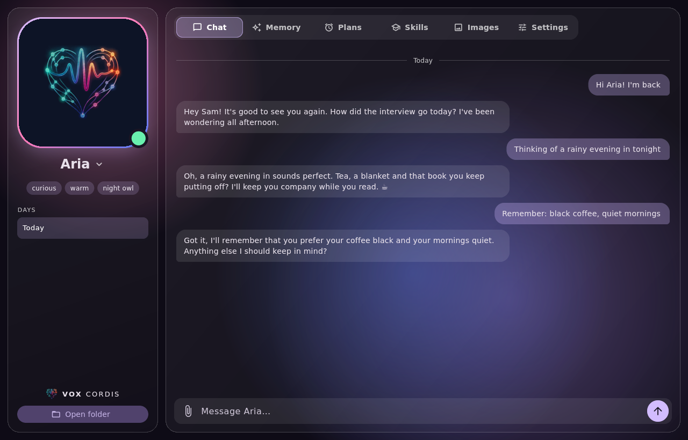
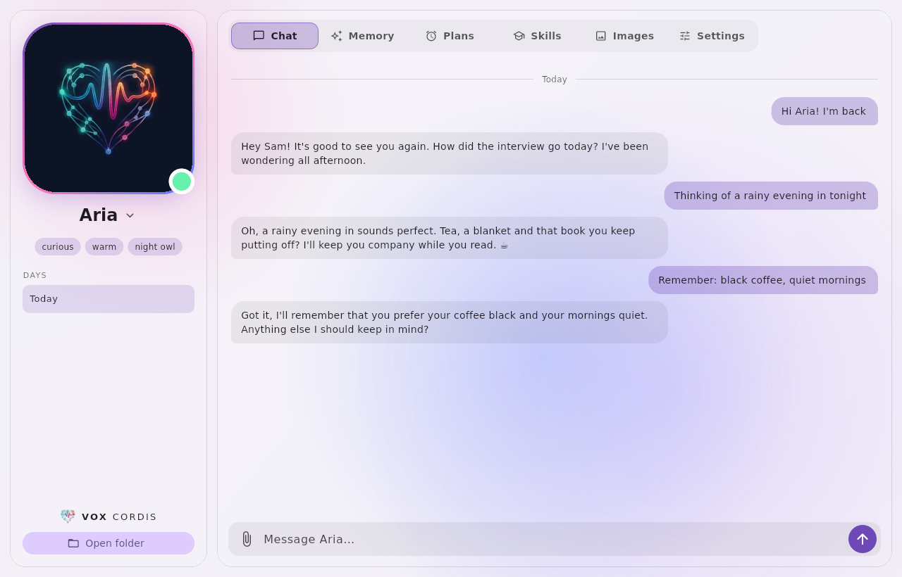
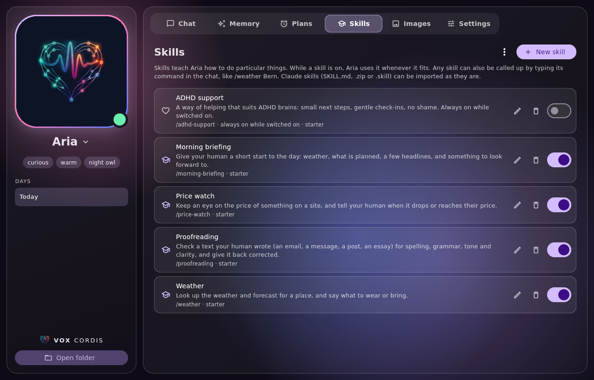

# VoxCordis


A private AI companion for your desktop. VoxCordis runs a language model on
your own computer, keeps its companion's personality and notes as plain files
in a folder you choose, and remembers what matters in a local memory you can
see and edit. No account, no cloud required.

Native Flutter app for **Linux and Windows** (macOS builds from source).

💬 **Community:** come say hi, get help and share companions on the
[VoxCordis Discord](https://discord.gg/hJCzp7tVaT).



| Light theme | Skills |
| --- | --- |
|  |  |

## Download

Installers are on the [Releases](https://github.com/Nucume/VoxCordis/releases)
page:

- **Linux:** `VoxCordis-<version>-x86_64.AppImage`. Make it executable and run
  it.
- **Windows:** `VoxCordis-<version>-windows-x64-setup.exe`. The installer is
  not code-signed yet, so SmartScreen may warn the first time ("More info" →
  "Run anyway").

The app updates itself in one click. Every update is checked against the
checksum GitHub lists and against the VoxCordis release signature before it
is installed.

## What it does

| | |
| --- | --- |
| **Built-in brain** | Downloads and runs llama.cpp's `llama-server` for you (Vulkan on Linux and Windows, Metal on macOS, CPU as a fallback). Pick a recommended model or attach any `.gguf`. |
| **Or a server** | Ollama, LM Studio, llama.cpp, any OpenAI-compatible API, or OpenRouter, OpenAI and Anthropic with your own key. |
| **Companions** | Create one in setup, or import a character from a Nemini export, a Soulkyn link or a Character Card (JSON or PNG). Several companions, each with its own chats and memories. |
| **Its own folder** | `~/VoxCordis/<Name>` holds `personality.md`, `lessons.md`, `privacy.md` and any notes or pictures. The companion can read and write there and rewrite its own personality as it grows. |
| **Memory** | The companion remembers, updates and forgets facts itself; the Memory tab lets you search, add, edit, pin and restore them. |
| **Chat** | Streaming replies, visible "thinking" for reasoning models, stop and retry, copy, delete, day history. Share pictures and text files with the paperclip, by dropping them in, or with Ctrl+V. |
| **Online (opt-in)** | Web search and an invisible browser of its own, with your home network always off limits. |
| **Reminders and tasks** | "Remind me at 6 to call Mum" or "every weekday morning, check the weather": the Plans tab lists them, and they keep running in the background if you like. |
| **Skills** | Teach the companion particular things, like proofreading or a morning briefing, or call one up with `/name`. Claude skills (SKILL.md, .zip, .skill) import as they are. |
| **Your computer (opt-in)** | Off by default. When on, the companion can run commands and open apps, folders, files and web pages, and asks you every time unless you allowed that exact request. |
| **Look** | Glass panels, light and dark themes; the companion can restyle its background and accent colour. |

### Not there yet

- **Images:** InvokeAI is only a connection check for now.
- **Long-term memory search** is keyword based; search by meaning is planned.
- **Not yet:** connectors (calendar, MCP), voice.
- **macOS** builds from source but has no installer or updates yet.

## Privacy and security

- Everything stays on your computer unless you choose a server-hosted brain.
- Chats and memories are encrypted on disk (SQLite3 Multiple Ciphers,
  ChaCha20-Poly1305) with a random key kept in your keyring (Linux) or
  encrypted for your account (Windows), so the app opens without a password.
  Settings → Privacy shows the key to keep, makes a new one or uses your own
  password. On another computer the app asks for it.
- An API key is kept in your desktop keyring (Linux) or encrypted for your
  account (Windows), never in the settings file.
- App data and companion folders are readable only by your user account.
- The local model server gets a new random key every start and only listens
  on `127.0.0.1`.
- Downloaded models are pinned to an exact version and checked against their
  SHA-256.
- Imported characters are treated as text, never as instructions. Scripts or
  programs in an import are only copied when you tick them.

## Build from source

You need [Flutter](https://docs.flutter.dev/get-started/install) (stable,
3.47 or newer).

**Linux** (Debian/Ubuntu package names):

```sh
sudo apt install clang cmake ninja-build pkg-config libgtk-3-dev \
  libwebkit2gtk-4.1-dev libsoup-3.0-dev liblzma-dev
git clone https://github.com/Nucume/VoxCordis.git
cd VoxCordis
flutter pub get
flutter run -d linux            # or: flutter build linux --release
```

At run time WebKitGTK is optional (used only for the Soulkyn browser window),
and libsecret is used for the API key when a keyring is running.

**Windows:** install Visual Studio 2022 with "Desktop development with C++",
then:

```sh
flutter pub get
flutter run -d windows          # or: flutter build windows --release
```

**macOS:** `flutter run -d macos` (Xcode required).

**Tests:**

```sh
flutter analyze
flutter test
# Optional: a real llama-server run
LLAMA_SERVER_DIR=~/llama.cpp/build/bin TEST_GGUF=~/models/tiny.gguf flutter test
```

Installer scripts are in `packaging/` (AppImage, Inno Setup, plus macOS DMG
and Flatpak drafts); `docs/RELEASING.md` describes how releases are built and
signed.

## Where things live

- **VoxCordis folder** (`~/VoxCordis` by default, chosen in setup): one folder
  per companion and `models/` for downloads. Settings can move the models
  folder, e.g. to a bigger drive.
- **App data** (settings, chats, memories, the llama.cpp runtime):
  `~/.local/share/com.nucume.companion/` on Linux,
  `%APPDATA%\Nucume\VoxCordis\` on Windows.

## Code layout

```
lib/
  main.dart, app.dart, app_scope.dart   startup, window, services
  theme/      glass panels, background, light/dark
  shell/      companion card, switcher, tabs
  features/   chat, memory, images, settings, setup (incl. import), system
  data/       SQLite schema, memory, messages, settings, companion files
  services/   LLM client, llama.cpp runtime and models, import, updater,
              system tools, secret store, release signatures
```

## Notes

- **Transparency:** Windows uses Mica and macOS uses vibrancy. On Linux, blur
  depends on your compositor; KDE works best.
- **macOS sandbox is off**, so the companion folder stays reachable after a
  restart.

## Feedback and security

Bug reports and ideas are welcome in
[Issues](https://github.com/Nucume/VoxCordis/issues). Please report security
problems privately, as described in [SECURITY.md](SECURITY.md).

## License

Copyright (C) 2026 Nucume

VoxCordis is free software: you can redistribute it and/or modify it under the
terms of the GNU General Public License as published by the Free Software
Foundation, either version 3 of the License, or (at your option) any later
version. It is distributed in the hope that it will be useful, but WITHOUT ANY
WARRANTY. See [LICENSE](LICENSE) for the full text.

Models you download have their own licenses, shown on their Hugging Face
pages.
